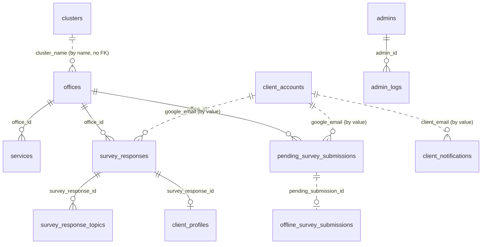

# Database Documentation: ERD and Data Dictionary (Checklist Items #4, #5)

DRAFT built from the `CREATE TABLE` statements in `admin-portal/server.js` (lines ~2083–2400), which are the source of truth. The app creates and alters these tables itself at startup (`CREATE TABLE IF NOT EXISTS` plus `ALTER TABLE ADD COLUMN`).

**Before turnover:** `cqa_db.sql` in the repo (dated Aug 31) is older than the live schema. It lacks tables such as `survey_response_topics`, `pending_survey_submissions`, `offline_survey_submissions`, `client_notifications`, `admins`, and `schema_migrations`. Regenerate it from the live database:
```
mysqldump --no-tablespaces -u USER -p cqa_db > cqa_db_full.sql          # schema + data
mysqldump --no-data --no-tablespaces -u USER -p cqa_db > cqa_db_schema.sql
```
Also, columns added later by `ALTER TABLE` (for example `offices.password`, `offices.full_name`, `services.availability`, `survey_responses.service_availed`, `client_submission_id`, `google_email`, `pending_survey_submissions.submission_source`, `admins.photo_url`, `login_token`, `notifications_seen_at`, `admin_logs.admin_id`, `session_id`) are not in the base definitions below. Confirm the final column list with `SHOW CREATE TABLE <name>` on the live DB.

## ERD

Solid lines are enforced foreign keys. Dotted lines are logical links by value (no FK constraint).

## Data dictionary

### clusters
| Column | Type | Notes |
|---|---|---|
| id | INT PK AI | |
| cluster_name | VARCHAR(150) UNIQUE | e.g. "Academic Cluster" |
| is_archived | TINYINT(1) | soft delete flag |
| created_at | TIMESTAMP | |

### offices
| Column | Type | Notes |
|---|---|---|
| id | INT PK AI | |
| cluster_name | VARCHAR(150) | matches clusters.cluster_name |
| office_name | VARCHAR(255) | |
| head_director | VARCHAR(255) | default "Not Assigned" |
| email_address | VARCHAR(255) | |
| is_archived | TINYINT(1) | soft delete |
| password | VARCHAR(255) NULL | bcrypt hash for office login (added by ALTER) |
| full_name | VARCHAR(255) NULL | added by ALTER |
| created_at | TIMESTAMP | |

### services
| Column | Type | Notes |
|---|---|---|
| id | INT PK AI | |
| office_id | INT FK to offices.id | ON DELETE CASCADE |
| service_name | VARCHAR(255) | |
| availability | VARCHAR(20) | default 'daily' (added by ALTER) |
| created_at | TIMESTAMP | |

### survey_responses
| Column | Type | Notes |
|---|---|---|
| id | INT PK AI | |
| office_id | INT FK to offices.id | ON DELETE CASCADE |
| respondent_name | VARCHAR(255) | default 'Anonymous' |
| topic | VARCHAR(100) | AI-assigned topic label |
| sentiment | VARCHAR(50) | AI-assigned (Positive/Neutral/Negative) |
| region | VARCHAR(100) | |
| cc1, cc2, cc3 | VARCHAR(100) | Citizen's Charter awareness answers |
| sqd0 to sqd8 | INT | Service Quality Dimension ratings |
| comments | TEXT | free-text feedback (sent to Gemini) |
| period_year_quarter | VARCHAR(50) | reporting period label |
| service_availed | VARCHAR(255) | added by ALTER |
| google_email | VARCHAR(255) | respondent link (added by ALTER) |
| client_submission_id | VARCHAR(64) UNIQUE | dedupe key (added by ALTER) |
| created_at | TIMESTAMP | |

### survey_response_topics
| Column | Type | Notes |
|---|---|---|
| id | INT PK AI | |
| survey_response_id | INT FK to survey_responses.id | CASCADE |
| topic | VARCHAR(150) | one response can have several topics |
| sort_order | INT | |

### client_profiles
| Column | Type | Notes |
|---|---|---|
| id | INT PK AI | |
| survey_response_id | INT FK to survey_responses.id | CASCADE |
| respondent_name, client_type, age, gender, region, email | VARCHAR | demographic snapshot per response |
| office_visited_time | DATETIME | |
| created_at | TIMESTAMP | |

### client_types
`id` INT PK, `type_name` VARCHAR(100) UNIQUE (Citizen, Business, Government, Student), `created_at`.

### survey_settings
`id` INT PK, `category` VARCHAR(50) (`sqd` or `cc`), `content` TEXT (question text), `created_at`, `is_archived`.

### client_accounts
| Column | Type | Notes |
|---|---|---|
| email | VARCHAR(255) PK | |
| respondent_name | VARCHAR(255) | |
| password | VARCHAR(255) NULL | bcrypt hash (null for Google-only accounts) |
| google_photo_url | VARCHAR(500) | |
| region, age, gender | VARCHAR | |
| onboarding_completed | TINYINT(1) | |
| created_at, updated_at | TIMESTAMP | |

### pending_survey_submissions
`id` PK, `office_id` FK to offices (CASCADE), `google_email`, `service_availed`, `payload` JSON (the full submission), `status` ('pending'/approved/declined), `decline_reason`, `reviewed_at`, `created_at`, `submission_source` ENUM('online','offline_sync','legacy_unknown') (ALTER).

### offline_survey_submissions
`id` PK, `offline_submission_id` VARCHAR(64) UNIQUE, `registered_identifier` (email), `office_id`, `verification_status` ENUM('verified','external_account'), `approval_status` ENUM('not_required','pending','approved','rejected'), `survey_response_id`, `pending_submission_id`, `created_offline_at`, `synced_at`.

### client_notifications
`id` PK, `client_email`, `type`, `title`, `message` TEXT, `survey_response_id`, `pending_submission_id`, `offline_submission_id`, `dedupe_key` UNIQUE, `is_read`, `created_at`, `read_at`, `deleted_at`. Indexed on email, inbox, and unread.

### admins
`id` PK, `username` UNIQUE, `password` (bcrypt hash), `fullname`, `gender`, `role` ('Admin' or 'Super Admin'), `created_at`, plus ALTER columns `photo_url`, `login_token`, `notifications_seen_at`.

### admin_logs
`id` PK, `username`, `login_time`, `logout_time`, `created_at`, plus ALTER columns `admin_id` (FK to admins.id, ON DELETE SET NULL) and `session_id`.

### schema_migrations
`name` VARCHAR(190) PK, `applied_at`. Tracks one-time data migrations.

## Sample data
Seeded automatically: `client_types` (4 rows), `survey_settings` (9 SQD + 3 CC questions), 4 clusters, and the two default admin accounts. Offices and services seed data live in `admin-portal/migrations/*.sql` and the old `cqa_db.sql`.
Do not hand over real respondent data (names, emails). Use an anonymized or empty export for the sample.

## Migrations folder
`admin-portal/migrations/*.sql` are one-off scripts from earlier changes. The app now applies equivalent changes itself, so list them in the Installation Guide as "not required on a fresh install".
